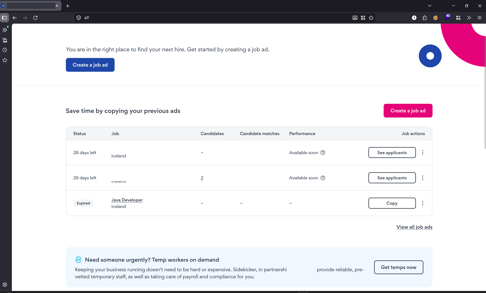
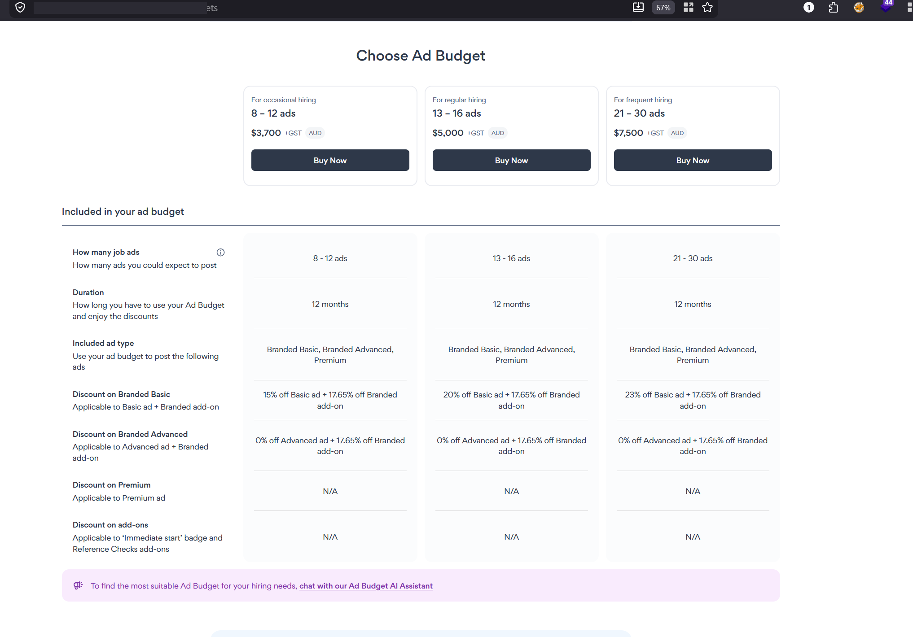
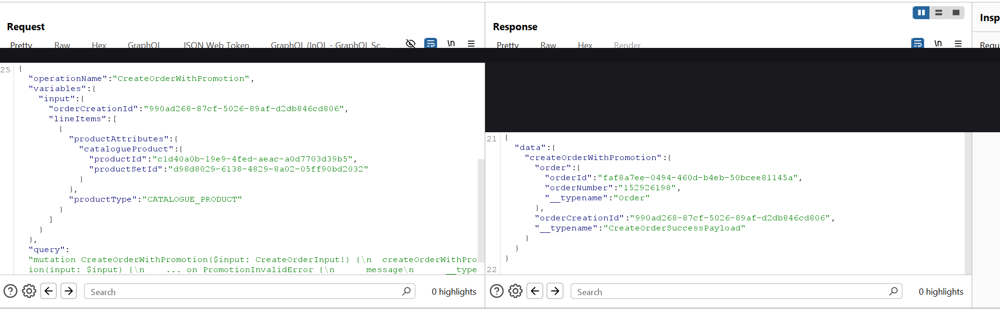
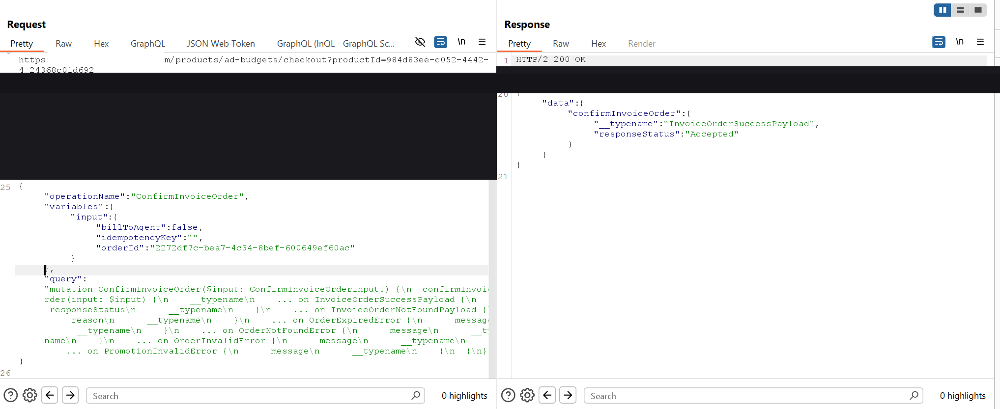
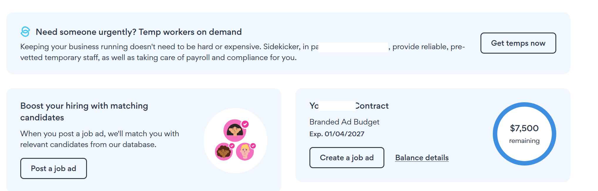
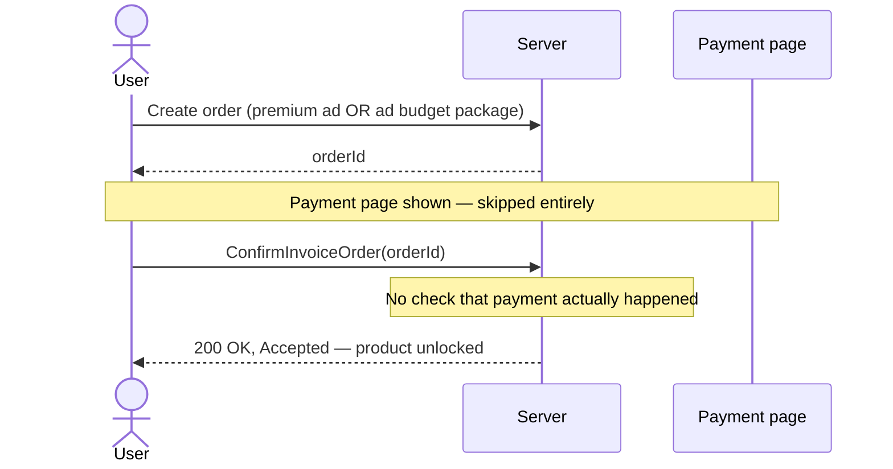
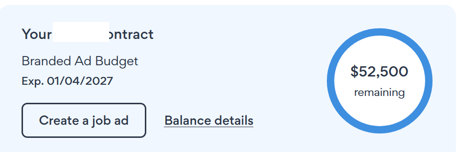
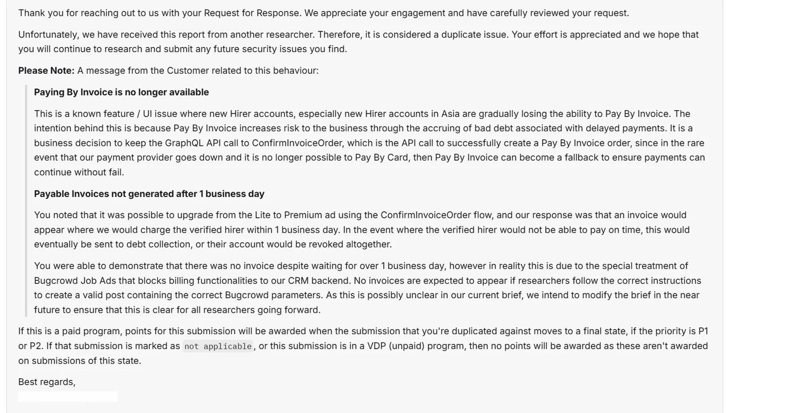

## Introduction

On an employer portal, companies pay for two kinds of things: **premium job ads** (a one-off boost for a single listing) and **ad budget packages** (a prepaid bundle of ads, priced from a few thousand dollars up to a yearly contract). Both end with the same step: the user pays, and the server marks an order as paid before unlocking the product.

I found that this "mark as paid" step trusts the client completely. Sending it directly, without ever paying, unlocks both the premium ad and the ad budget package.

## Background: how the order flow works

For any paid product on this portal, the flow is:

1. The client asks the server to create an order for the chosen product → the server replies with an `orderId`.
2. The user is shown a payment page to enter card details.
3. Once payment succeeds, the client calls a `ConfirmInvoiceOrder` GraphQL mutation with that `orderId` → the server marks the order paid and unlocks the product.

The problem is step 3. The mutation never checks that step 2 actually happened.

## Bug 1: Publishing a premium job ad for free

While creating a job ad, I selected a premium package and went through the normal flow until the "enter payment details" screen. Instead of entering a card, I opened Burp, found the `orderId` already generated for that order, and sent the `ConfirmInvoiceOrder` mutation directly:

```json
{
  "operationName": "ConfirmInvoiceOrder",
  "variables": {
    "input": {
      "billToAgent": false,
      "idempotencyKey": "",
      "orderId": "<captured orderId>"
    }
  }
}
```

The server replied `200 OK` with `"responseStatus":"Accepted"`, and the job was published as Premium without any payment. It wasn't just marked premium internally — the listing went live and picked up real applicants:

{: w="850" }
_The bypassed listing, live and receiving candidates_

## Bug 2: The same trick unlocks paid Ad Budget packages

While looking for other paid features that might share this logic, I found the **Ad Budgets** page, which sells prepaid packages of job ads for a flat price:

{: w="800" }
_Packages range from $3,700 to $7,500, each valid for 12 months_

Clicking "Buy Now" on a package goes to a checkout page, and before any payment is entered, the client already calls `CreateOrderWithPromotion` to create the order:

{: w="900" }
_The checkout page creates an order up front, before payment_

That's the same shape as the premium-ad flow: an `orderId` exists before payment. So I tried the exact same `ConfirmInvoiceOrder` mutation from Bug 1, this time with the ad-budget order's `orderId`:

{: w="900" }
_Same mutation, different product — same result_

It worked identically. The full package was added to the account, with no card charged:

{: w="800" }
_The $7,500 package, fully usable, zero dollars paid_

## Root cause



`ConfirmInvoiceOrder` is treated as the source of truth for "this order was paid." It isn't tied to any signal from the payment gateway — no charge confirmation, no webhook, nothing. Whoever holds a valid `orderId` can confirm it, whether or not a cent changed hands. Because order creation happens automatically and early in both flows, getting that `orderId` requires no special access — just reaching the checkout step.

## Impact

- Any premium job ad, and any ad budget package (including the largest, $7,500 tier), can be obtained for $0.
- The bug is not account-specific: it was reproduced on multiple fresh accounts.
- It's fully repeatable with no server-side detection — the same account accumulated tens of thousands of dollars in free ad budget across repeated tests, with no block, flag, or reversal:

{: w="800" }
_No limit, no detection, across repeated runs_

- Because ad budget packages are the platform's highest-value product and this requires nothing beyond a free account, the issue is directly scalable to significant revenue loss.

## Remediation.

- Never treat `ConfirmInvoiceOrder` (or any client-triggered "confirm" mutation) as proof of payment. Require a server-to-server signal from the payment gateway (a webhook or equivalent) before marking an order paid.
- Separate "order confirmed" from "product granted" — grant the product only after independent payment verification, not as a side effect of the same client call.
- Apply this check uniformly across every flow that reuses the order/confirm pattern, since the same logic was reachable from at least two unrelated products.

## Outcome

Closed as **Not Applicable** / duplicate after review by the people running the bug bounty program, with their thanks for the report:

{: w="900" }
