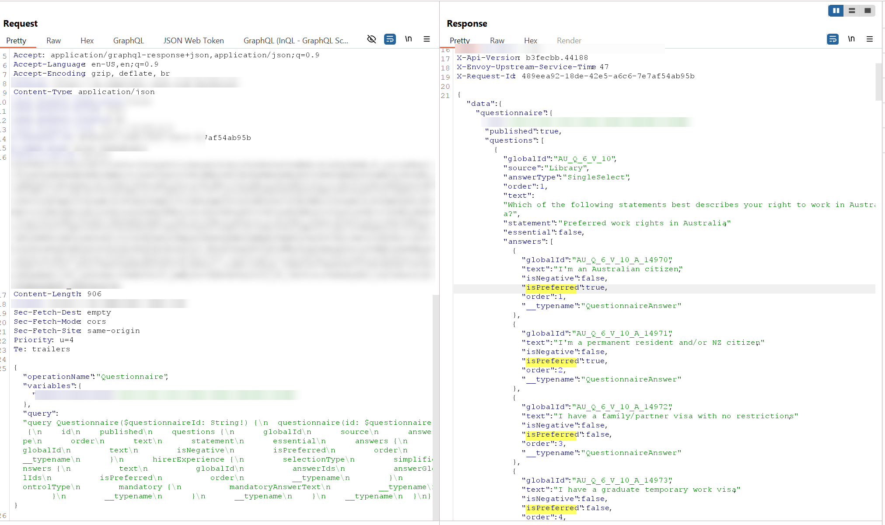
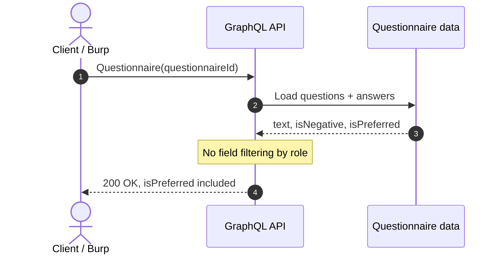
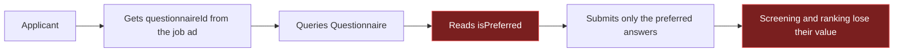
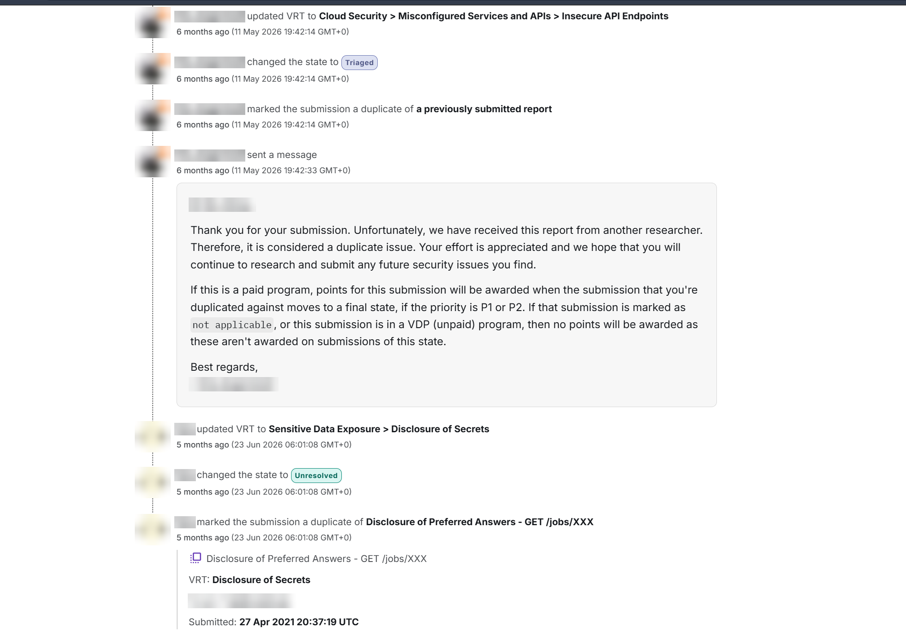

## Introduction

On a job platform, employers can attach **screening questions** to a job ad. For each question they can mark some answers as **preferred**, which is the internal logic used to rank and shortlist applicants.

That flag is never meant to be seen by applicants. I found that the GraphQL API returns it as a normal field, to anyone who can query the questionnaire.

## TL;DR

| | |
|---|---|
| **Vulnerability** | Information Disclosure (internal hiring logic exposed) |
| **Endpoint** | `POST /graphql`, operation `Questionnaire` |
| **Parameter** | `questionnaireId` |
| **Leaked field** | `isPreferred` on every answer |
| **Root cause** | An employer-only field is part of the shared query result, with no server-side filtering |
| **Impact** | Applicants can pick the "right" answers and defeat the screening |

## How it works

Every job ad has a `questionnaireId`, which the front end uses to load the screening questions. The query behind it is `Questionnaire`, and the part that matters is the `answers` selection:

```graphql
query Questionnaire($questionnaireId: String!) {
  questionnaire(id: $questionnaireId) {
    questions {
      text
      answers { text isNegative isPreferred }
    }
  }
}
```

I replayed this request in Burp Repeater with the `questionnaireId` of one of my own test ads. The response lists every answer with its `isPreferred` value:

{: w="800" }
_The `isPreferred` flag comes back for every answer. Headers, token and IDs are blurred_

In the example above, two of the four answers are marked `"isPreferred": true`. These are exactly the ones the employer wants to see.

## Root cause

The API returns the whole questionnaire object, including the employer's private settings. The front end only *shows* the answer options, but the data sent to the client carries the answer key with it. Anything the client receives, the user can read.



## Impact



If the preferred answers are readable, the filter stops measuring candidates and starts measuring who knows the answer key. Honest applicants are ranked below those who read the flag, and the employer gets a shortlist they cannot trust.

> The proof of concept used questionnaires from my own ads. The risk comes from the field itself being part of a normal response, not from any special access.
{: .prompt-info }

## Remediation

- Remove `isPreferred` and other employer-only fields from the response unless the requester is the owner of the job ad.
- Use separate GraphQL types (or field-level authorization) for the applicant view and the employer view.

## Outcome

Reported as **P4**. It was marked as a **duplicate** of an existing report, originally submitted in 2021.

{: w="700" }
_Marked as a duplicate. Names and program details are blurred_
