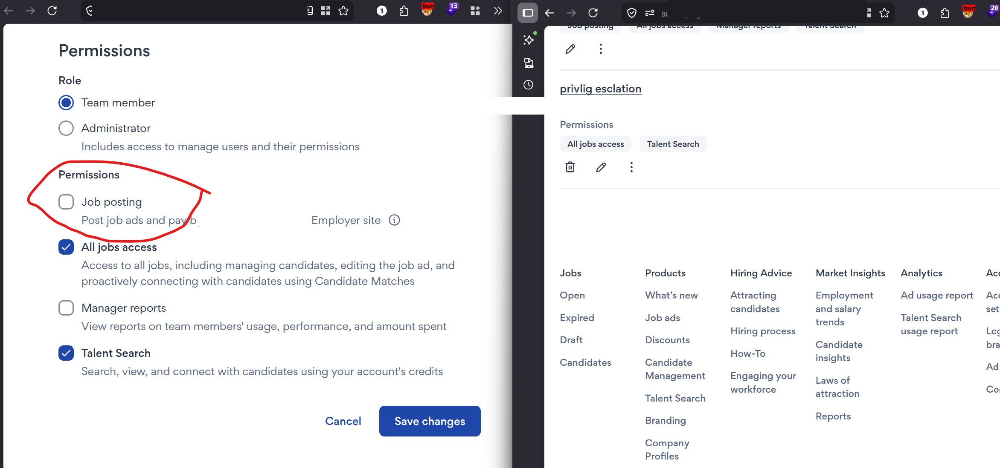
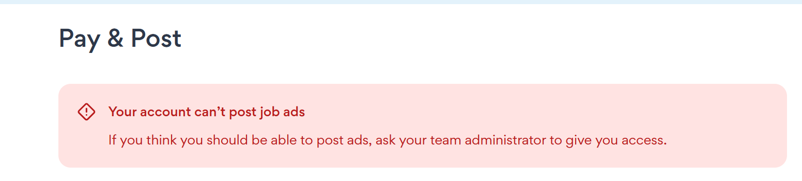
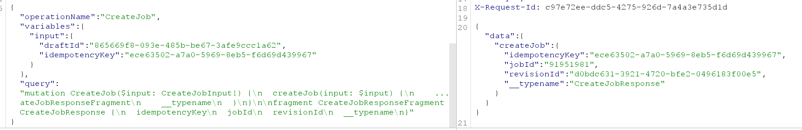
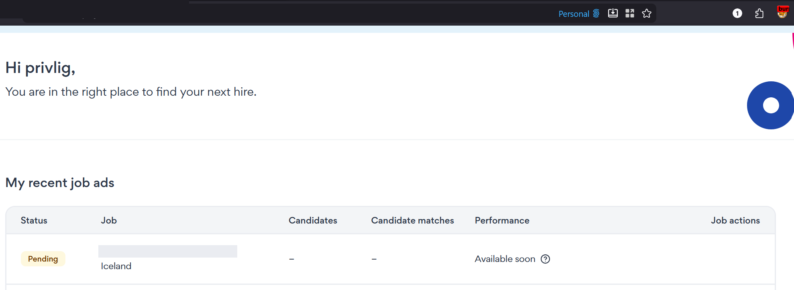
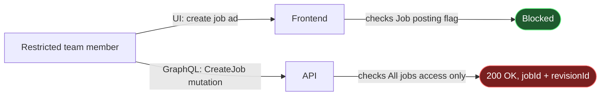
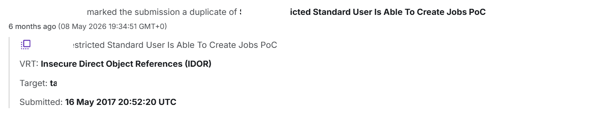

## Introduction

On an employer portal that lets a company invite team members with limited permissions, I found a **Privilege Escalation** bug: a team member who is explicitly denied the permission to post job ads can still create one, because the permission is enforced by the UI only, not by the backend.

## The permission model

A team member account has several independent permission toggles, two of which matter here:

- **Job posting** — allowed to create and pay for job ads.
- **All jobs access** — allowed to manage every job in the account (candidates, editing, etc.).

The intent is clear: only **Job posting** should allow creating a new ad. **All jobs access** is about managing existing jobs, not creating new ones.

## Setting up the test

I created a team member account and granted it **All jobs access** only, while explicitly leaving **Job posting** unchecked.

{: w="800" }
_"Job posting" is off, "All jobs access" is on_

As expected, the UI blocked the normal flow:

{: w="600" }
_"Your account can't post job ads"_

## Bypassing it at the API level

The UI block only stops the *page*, not the underlying GraphQL API. Using this same restricted account, I intercepted traffic in Burp and sent the `CreateJob` mutation directly:

```graphql
mutation CreateJob($input: CreateJobInput!) {
  createJob(input: $input) {
    ... on CreateJobResponseFragment {
      idempotencyKey
      jobId
      revisionId
      __typename
    }
  }
}
```

The server replied `200 OK` and returned a real `jobId` and `revisionId`, exactly as it would for an authorized user:

{: w="700" }

These two values are the keys to the rest of the job-creation flow: with them, the job can be driven through the remaining steps and ends up live on the account, in **Pending** status, despite the account never having had permission to post it.

{: w="800" }
_The job the restricted account was never allowed to create_

## Root cause



The `CreateJob` mutation does not check the **Job posting** permission at all. It only checks **All jobs access**, which was never meant to control job *creation* — just management of existing jobs. Because of this mismatch, any account with **All jobs access** can create jobs regardless of what the administrator set for **Job posting**.

| Job posting | All jobs access | UI | `CreateJob` API |
|---|---|---|---|
| ❌ | ❌ | Blocked | `403` |
| ❌ | ✅ | Blocked (same message) | `200` — returns `jobId` / `revisionId` |
| ✅ | — | Allowed | `200` |

## Impact

A team member can be granted **All jobs access** for entirely unrelated reasons (to manage candidates on existing ads, for example) without the administrator ever intending to let them post new ones. Because the backend authorization is tied to the wrong flag, that team member can create job posts on the company's account regardless of the explicit restriction.

> The `jobId` and `revisionId` obtained this way are also what is needed to drive the rest of the posting flow. How that flow mishandles payment is a separate issue, covered in its own report.
{: .prompt-info }

## Remediation

- Enforce the **Job posting** permission inside the `CreateJob` mutation itself, independently of **All jobs access**.
- Return `403 Forbidden` when the specific permission required for an action is missing, instead of relying on a broader, unrelated flag.
- Audit other mutations for the same pattern: a broad permission silently covering for a narrower one the UI assumes is enforced server-side.

## Outcome

The report was marked as a **duplicate** of an existing report describing the same restricted-user bypass, originally submitted in 2017.

{: w="800" }
