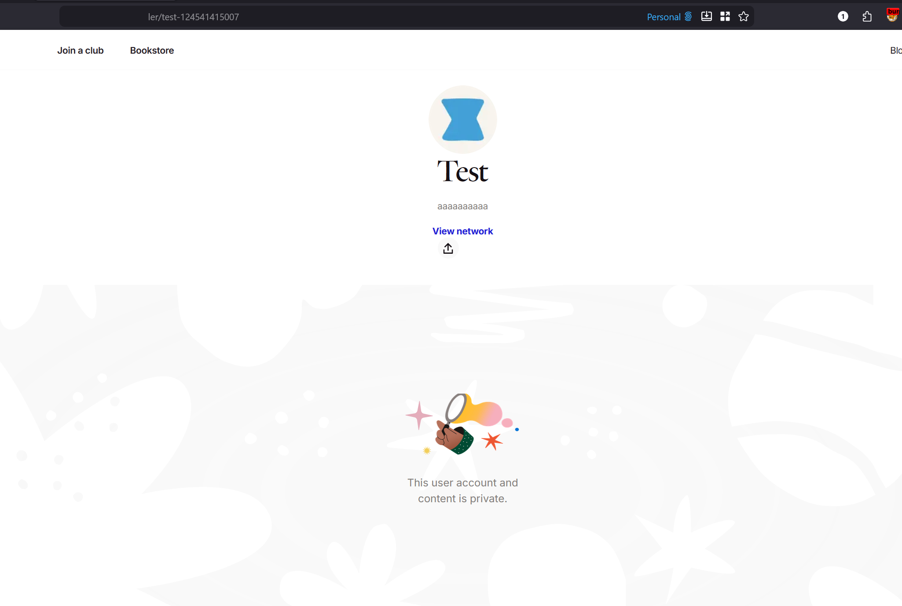
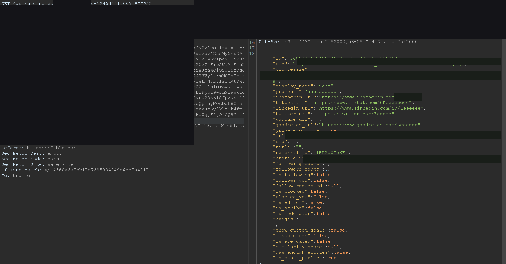
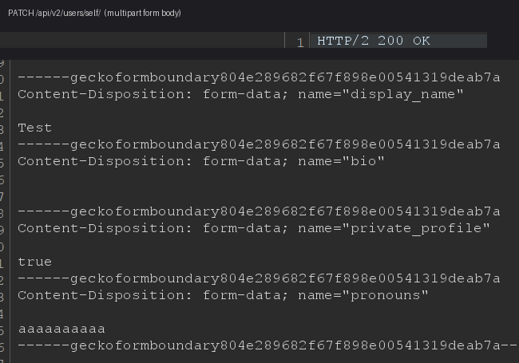

## Introduction

On a social platform, users can make their profile **Private**. Once enabled, the UI correctly hides everything — no picture, no bio, no social links, nothing. I found that the backend API behind user profiles never checks this setting: any logged-in user can still pull the full profile object for a private account, just by knowing their username.

## What "Private" is supposed to do

Visiting a private profile in the browser shows exactly what it should — nothing:

{: w="800" }
_"This user account and content is private"_

This confirms the restriction works from the UI's point of view. The problem is one level down, in the API that serves this page.

## The vulnerable endpoint

The profile page loads its data from:

```
GET /api/usernames/<username>
```

I called this endpoint directly with a valid session, using the username of an account set to private, and the server returned the complete profile object anyway:

{: w="900" }
_`"private_profile":true` right next to the data that should be hidden by it_

The response includes the user ID, display name, bio, pronouns, profile picture, every linked social media URL, follower/following counts, follow and block status, role flags (editor/scribe/moderator), and several other internal fields — all for an account the UI says is completely private.

## A side note: setting "Private" isn't even a UI option

While building a private test account to check this, I noticed the **Edit Profile** form has no toggle for privacy at all. I found it by editing an unrelated field (like the bio) and intercepting the `PATCH` request to the profile endpoint: the server accepts a `private_profile` field in that request even though the client never sends it. Setting it to `true` manually flips the account to private just fine.

{: w="650" }
_A parameter with no UI control, accepted anyway_

This isn't the main vulnerability by itself, but it shows the same pattern: the client's interface is treated as the only gatekeeper, and the backend trusts whatever it's sent.

## Root cause

```mermaid
sequenceDiagram
    actor A as Any logged-in user
    participant UI as Web UI
    participant API as Profile API

    rect rgb(40,60,40)
    Note over A,UI: Through the UI
    A->>UI: Open private profile page
    UI-->>A: "This account is private"
    end

    rect rgb(70,40,40)
    Note over A,API: Direct API call
    A->>API: GET /api/usernames/victim
    Note over API: private_profile never checked
    API-->>A: 200 OK, full profile object
    end
```



The endpoint that serves profile data has no authorization check tied to `private_profile`. It treats every requester as if they were allowed to see the full object, and leaves it to the frontend to decide not to render it. Anyone skipping the frontend — Burp, curl, a script — gets everything.

## Impact

- Full profile metadata for any private account is readable by any authenticated user, including social media links, which can be used to deanonymize or track someone who deliberately chose to hide their profile.
- No special permissions are needed — just a username and a logged-in session on any account.
- Because the check is missing entirely rather than just misconfigured, this affects every private profile on the platform, not a specific edge case.

## Remediation

- Enforce the `private_profile` check server-side, in the same endpoint that returns the profile object — not only in the UI layer.
- For a private profile, return just the minimal public fields (or a 403) to non-followers/non-owners, the same way the UI already represents it.
- Audit other endpoints that expose user data for the same gap, since the privacy flag clearly isn't propagated consistently across the API.
- Review which profile fields should ever be writable by the client at all; a field with no UI control being silently accepted is a sign the backend isn't validating the allowed input shape.

## Outcome

Accepted, rated **Low** severity, and rewarded with a **$100** bounty.
