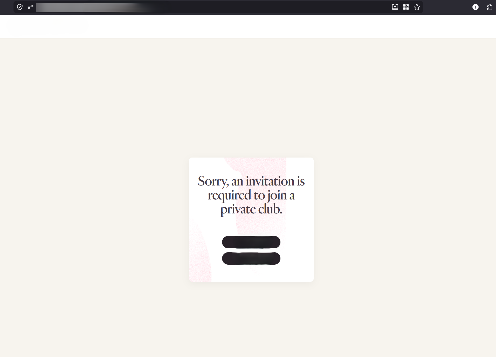
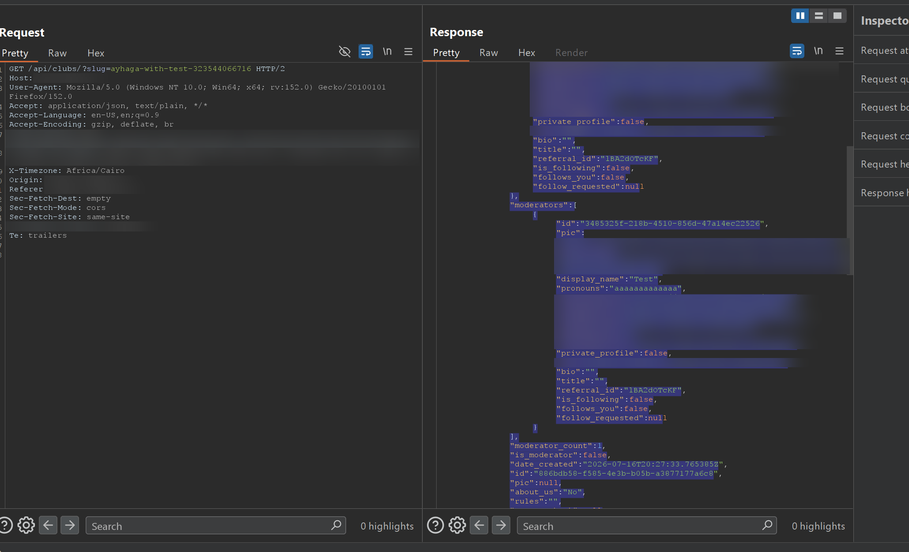
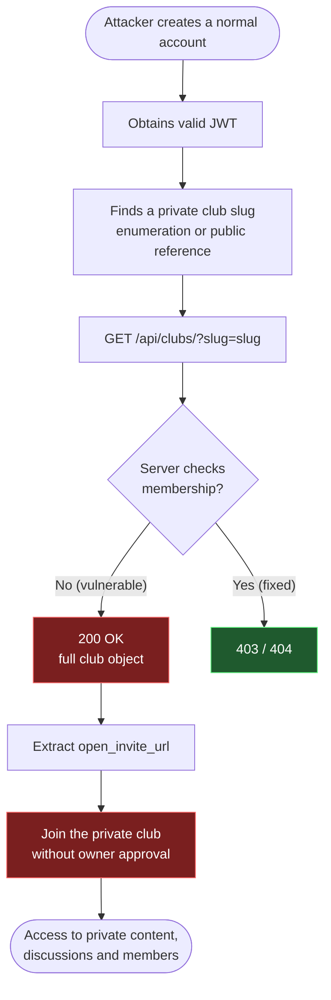

## Introduction

While testing a social platform that lets users create **public** and **private** communities (called *clubs*), I found a **Broken Access Control** issue in the API.

The web UI correctly refuses to show a private club to people who are not invited. The API behind it does not. A single `GET` request, made by any logged-in user, returns the full details of a private club, including a **working invite link** that lets the requester join without the owner's approval.

## TL;DR

| | |
|---|---|
| **Vulnerability** | Broken Access Control (missing authorization check) |
| **Endpoint** | `GET /api/clubs/?slug=<club-slug>` |
| **Required access** | Any authenticated user (no membership needed) |
| **Root cause** | The API checks *who you are* (authentication) but never checks *whether you are allowed to see this club* (authorization) |
| **Impact** | Private club data exposure, plus leaked invite links that allow joining without owner approval |

## Background: how private clubs are supposed to work

A club has an `access_type`:

- **public**: anyone can view the club and join it.
- **private**: only invited members can access it. Everyone else should be blocked.

When I opened a private club as a non-member in the browser, the UI blocked me with a message saying an invitation is required to join.

{: w="700" }
_The web UI correctly says an invitation is required_

So from the user's point of view, private clubs are properly protected. The problem is that this protection only exists in the front end.

## The vulnerable endpoint

The front end loads club information from this API call:

```http
GET /api/clubs/?slug=<private-club-slug> HTTP/2
Host: api.[REDACTED]
Authorization: JWT <valid_token>
```

The `slug` is the last part of the club URL, so it is easy to get. The server takes the slug, finds the club, and returns it. The only thing it validates is that the JWT is valid.

I sent this request using an account that is **not a member** of the private club, and the server replied with `200 OK` and the full club object.

{: w="800" }
_Request and response in Burp Suite. Sensitive values are blurred_

A trimmed version of the response shows the important fields:

```json
{
  "results": [{
    "title": "[REDACTED]",
    "access_type": "private",
    "is_moderator": false,
    "member_count": 1,
    "id": "886bdb58-f585-...",
    "creator": {
      "display_name": "Test",
      "instagram_url": "[REDACTED]",
      "tiktok_url": "[REDACTED]",
      "linkedin_url": "[REDACTED]",
      "twitter_url": "[REDACTED]",
      "goodreads_url": "[REDACTED]"
    },
    "moderators": [ "..." ],
    "open_invite_url": "https://[REDACTED]/...",
    "deep_link_url": "https://[REDACTED]/...",
    "push_channel": "private-club:886bdb58-...",
    "lobby_room_id": "531da375-..."
  }]
}
```

Two things stand out:

- `"access_type": "private"` and `"is_moderator": false` confirm that I was a non-member looking at a private club.
- `open_invite_url` and `deep_link_url` are the invite links of the club.

## Root cause

The backend treats the request as "logged in, so allowed". It never asks:

> Is this user a member of this club, or is the club public?

The privacy rule exists only in the UI code, which decides what to *show*. The API, which decides what to *return*, has no rule at all. Anyone who talks to the API directly (Burp, curl, a script) skips the UI and gets everything.

```mermaid
sequenceDiagram
    autonumber
    actor U as Non-member user
    participant UI as Web UI
    participant API as Clubs API

    rect rgb(40, 60, 40)
    Note over U,UI: Normal path (UI)
    U->>UI: Open private club page
    UI-->>U: "An invitation is required"
    end

    rect rgb(70, 40, 40)
    Note over U,API: Direct API call (vulnerable)
    U->>API: GET /api/clubs/?slug=private-club
    Note over API: Valid JWT? yes. Is member? never checked
    API-->>U: 200 OK + full club data + open_invite_url
    end
```



## Private vs Public: what changes

For a **public** club, returning this data is normal behavior. The bug is that a **private** club gets exactly the same treatment.

| | Public club | Private club (expected) | Private club (actual) |
|---|---|---|---|
| **UI, non-member** | Club page visible | Blocked, invitation required | Blocked, invitation required |
| **API, non-member** | `200` + club data | `403` / `404` | **`200` + full club data** |
| **Invite link exposed?** | Not sensitive, club is open anyway | Must stay secret | **Leaked in the response** |
| **Creator and moderator info** | Visible | Members only | **Leaked in the response** |
| **Where the check happens** | Not needed | Backend | **Front end only** |

The same request returns the same kind of data whether the club is public or private. The server simply does not look at `access_type` when deciding who may read the club.

## Impact

### 1. Joining a private club without approval

The response contains `open_invite_url` and `deep_link_url`. In a private club, the invite link is the thing that is supposed to be secret and controlled by the owner. A non-member who reads it from the API can follow it and enter the club, bypassing the owner's approval completely.

### 2. Exposure of club and user metadata

Even without using the invite link, the response leaks:

- Club title, description, rules, creation and update timestamps
- Member count and club configuration (`access_type`, theme, capabilities)
- Creator and moderator profile details, including linked social media accounts
- Internal identifiers such as the club UUID, `push_channel`, and `lobby_room_id`

### Attack chain



> Information disclosure becomes **unauthorized access** because the leaked data includes the key (the invite link) to the protected resource.
{: .prompt-warning }

## Steps to reproduce

1. Create an account and get a valid JWT.
2. Open a private club that you are **not** a member of. The UI shows that an invitation is required.
3. Intercept any API call in Burp Suite and send the following request:

   ```http
   GET /api/clubs/?slug=<private-club-slug> HTTP/2
   Host: api.[REDACTED]
   Authorization: JWT <valid_token>
   ```

4. The server answers `200 OK` with the full club data, including `open_invite_url`.

## Outcome

The report was triaged as **Low** severity and rewarded with a **$100** bounty.
